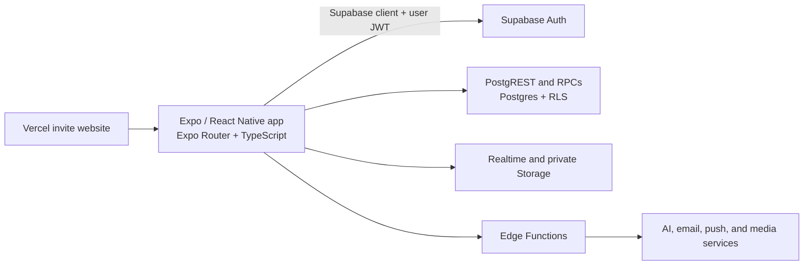

# Sniff.in


**Skip the introduction. Start the connection.** Sniff.in helps people in the same campus, hostel, club, event, pub, or conference turn shared context into a conversation or a plan. This repository contains the **3.3.1 campus-pilot source** for its iOS and Android app, Supabase backend, and invite website.

> Public source for review. Copyright © 2026 Nikhil Jain. All rights reserved. There is no open-source license or permission to reuse the code.

## What the app looks like

Sniff.in uses warm cream backgrounds, violet actions, teal availability accents, rounded cards, and Plus Jakarta Sans type. It supports light and dark appearance. Three illustrated introduction cards explain communities, activities, and connecting before sign-in. The main navigation has five tabs:

| Screen | What people see and do |
| --- | --- |
| **Home** | Relevant people, active Servers, activities, and an account-wide **Available** switch. |
| **Servers** | Joined communities and places to explore. A Server row opens its message feed; separate invite-copy and settings icons have their own actions. |
| **Activities** | Nearby or Server-scoped plans, participant counts, and **I'm in** responses. |
| **Chats** | Private conversations, a row of short photo-and-note updates, and a compact message-requests button. |
| **Me** | Photo, friend count, badges, profile details, public preview, and Settings. |

Permanent Servers represent ongoing communities. Temporary Servers represent venues or events and expire. In a Server message feed, admins and moderators can post text and supported media; members can read. A private connection starts with one request and one acceptance, which connects both people and opens one shared chat. Profiles and matching show shared interests or community context, with audience controls for personal and professional details.

The interface also includes invite links and QR codes, chat photos/files/GIFs/stickers, activity photos, feedback with attachments, optional location sharing, reporting/blocking, and opt-in AI conversation starters. Some integrations need project credentials or provider configuration; see **Current limits** below.

## How it is made



- **Mobile:** Expo SDK 58, React Native, Expo Router, TypeScript, React Query, Zustand, React Hook Form, and Zod. Screens live in `src/app`; reusable components and feature APIs live outside the route tree.
- **Backend:** Supabase Postgres migrations define the schema, row-level security policies, database functions, Server roles, social relationships, media metadata, and cleanup jobs. Edge Functions handle operations that require server-side credentials. Realtime updates chats and other live views.
- **Storage and privacy:** Media uses controlled buckets and signed access. Client builds receive only publishable configuration. Service-role, email, AI, push, and signing credentials belong in local environment files or hosted secret stores.
- **Website:** `web/` contains the invite and Android-download landing site. Downloadable APK/IPA binaries are deliberately excluded from this source repository.

| Directory | Purpose |
| --- | --- |
| `src/app/` | Expo Router screens and navigation |
| `src/components/`, `src/theme/` | Shared UI and design tokens |
| `src/features/`, `src/lib/` | Feature APIs, hooks, client setup, validation, uploads |
| `supabase/migrations/` | Ordered database changes and access rules |
| `supabase/functions/` | Server-side functions |
| `supabase/tests/` | Database authorization and flow checks |
| `web/` | Invite site and Android download route source |
| `docs/` | Architecture, setup, testing, release, and known limits |

## Run it locally

Use Node.js 22 and a development Supabase project. Native device builds also need a compatible Android or iOS toolchain, or an EAS account.

```bash
npm ci
cp .env.example .env
# Fill in the publishable Supabase URL and anon/publishable key in .env.
npx expo start
```

Apply the SQL migrations to **your own** Supabase project and configure the required Edge Function secrets before exercising backend-dependent flows. Never put a service-role key, database password, Google client secret, AI key, or signing credential in `EXPO_PUBLIC_*` variables or commit them. See [setup](docs/SETUP.md), [architecture](docs/ARCHITECTURE.md), and [authentication setup](docs/AUTH_METHODS.md).

For an installed development build, follow the Expo/EAS steps in [setup](docs/SETUP.md). `app.config.ts` reads local build settings such as `APP_LINK_DOMAIN` and an optional, ignored `google-services.json`.

## Checks

```bash
npm run lint
npm run typecheck
npm test -- --runInBand
```

Database and Edge Function checks are described in [testing](docs/TESTING.md).

## Current limits

This is a **campus pilot**, not a claim of App Store or Play Store publication. Email sign-in works with a configured Supabase project; Google sign-in and phone OTP require their providers to be enabled before those buttons can complete sign-in. Free-Apple-account iOS builds require local signing and periodic renewal; signed distribution builds are not stored here. Live, multi-account media and feedback-delivery flows should be verified on devices before launch.
